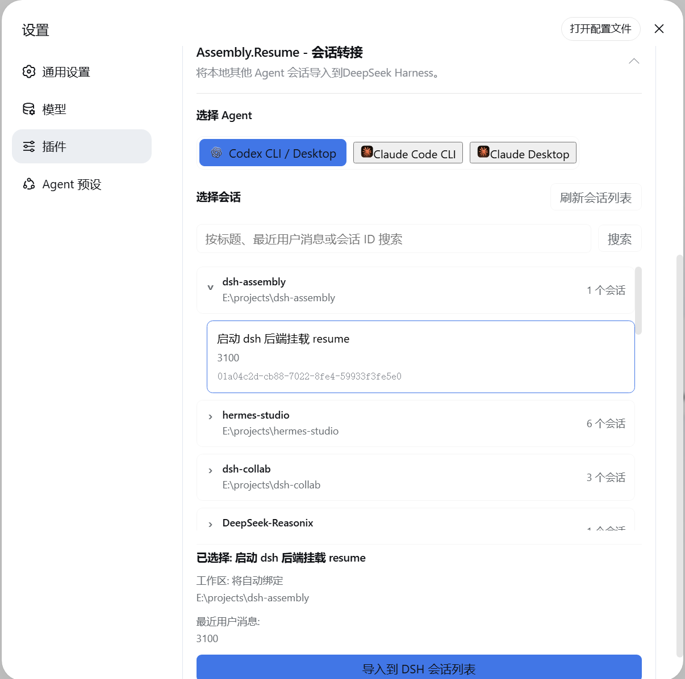

# dsh-assembly.resume

Bring an existing Codex or Claude Code conversation into DSH, then continue it
with the DSH Agent.

## DSH Compatibility

- Supported DSH version: [`0.1.7-rc.2`](https://github.com/deepseek-ai/deepseek-harness/releases/tag/dsh-v0.1.7-rc.2) (Sep.24)

## What It Does

- Finds local conversations from Codex, Claude Code CLI, and Claude Code Desktop.
- Groups conversations by their original project so they are easier to find.
- Imports the selected conversation into DSH, including its visible messages and tool activity.
- Automatically registers and binds an existing source directory as a DSH Workspace.
- If the historical path no longer exists or the original conversation had no workspace, a new workspace can be specified during handoff. Otherwise, the conversation imports unbound and the old directory is never recreated.
- Continue the conversation in DSH after transfer.



## Installation

Install the package from npm:

```bash
npm install dsh-assembly.resume
```

Add it to a DSH profile:

```bash
dsh plugin --profile web add dsh-assembly.resume
```

Start DSH:

```bash
dsh web
```

Open Settings > Plugins and select **Session Resume** to choose a provider and
conversation.
